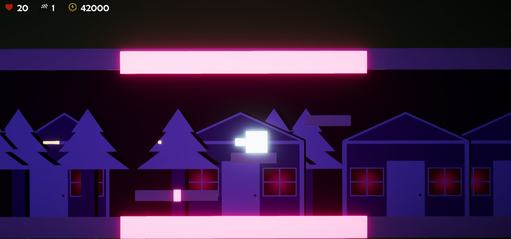

CubeGame sends a cube through platforming levels in a world ruled by bosses. Two of its tools change how you get through a difficult section.

## Put down a flag

The respawn flag lets you choose where to return after hitting lava. Without a flag, you return to the starting point and lose health. Place a flag before a section you expect to try more than once.

## Use an electrical platform

An electrical platform can help you skip a difficult section. Each use takes one battery charge, and charges can be bought at the shop.

## Keyboard controls

| Action | Key |
| --- | --- |
| Move | WASD |
| Jump | Space |
| Shoot | E |
| Interact | R |
| Place a flag | F |

Programming and game design are credited to Iliya Soleymani and Radin Nasiri. The game page has the full art, audio and testing credits, along with download links.

[Visit the CubeGame game page](/games/cubegame)
