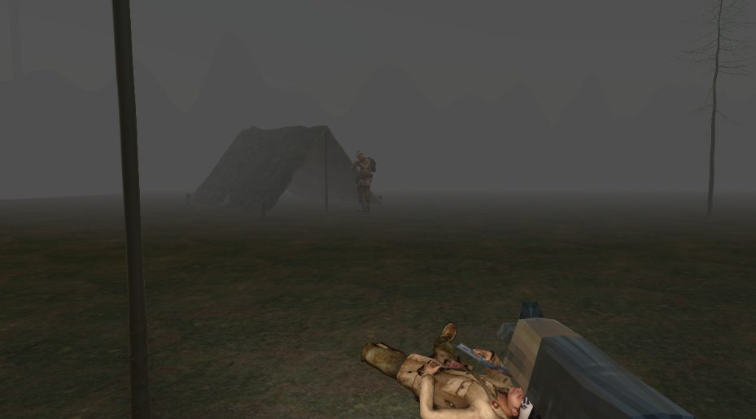

This archive entry follows the July 16, 2024 date recorded in the II Games catalog.

No man’s land is a short first-person game about trench warfare in World War I. Its PS1-inspired graphics keep the setting rough and low-resolution.

## War as a frightening experience

The game tries to show war as a sad and often scary experience within a short play session. That is the starting point for its setting and perspective.

## Playing the game

Use WASD to move, the left mouse button to shoot and Space to jump. The game page has browser and Windows links, screenshots and resource credits.

[Visit the No man’s land game page](/games/nomansland)
